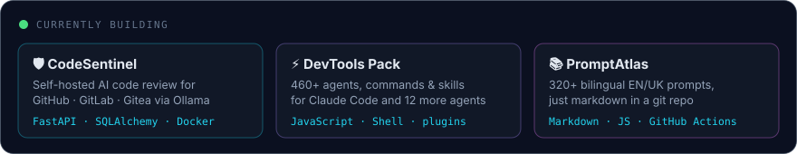

<p align="center">
  
</p>

<p align="center">
  
</p>

<p align="center">
  <a href="https://github.com/Mattakushi432?tab=repositories"></a>
  <a href="https://github.com/Mattakushi432?tab=followers"></a>
  
  
</p>

---

### `$ cat about.md`

I'm Maksym — a Python developer from Ukraine. I started with algorithms and
core Python, went through the full web track (Flask → Django → FastAPI,
SQL → SQLAlchemy → MongoDB, threads → asyncio → message queues), and now spend
most of my time on **tools that make developers faster**: self-hosted AI code
review, skill packs for AI coding agents, and small Windows utilities that do
one job well.

What ties it together: I like software that runs **on your own machine**,
explains itself, and doesn't phone home. Local LLMs over cloud APIs where it's
possible, a Docker Compose file over a ten-page setup guide, a single `.exe`
over an installer that wants admin rights for no reason.

I write docs in English and Ukrainian (sometimes Russian) — bilingual
projects are a habit, not an afterthought.

---

### `$ ls ~/stack`

<table>
  <tr>
    <td width="150"><b>Backend</b></td>
    <td>
      
      
      
      
      
      
      
      
    </td>
  </tr>
  <tr>
    <td><b>Data &amp; queues</b></td>
    <td>
      
      
      
      
      
      
    </td>
  </tr>
  <tr>
    <td><b>AI &amp; agents</b></td>
    <td>
      
      
      
      
      
    </td>
  </tr>
  <tr>
    <td><b>Desktop &amp; bots</b></td>
    <td>
      
      
      
      
      
      
    </td>
  </tr>
  <tr>
    <td><b>Infra &amp; tooling</b></td>
    <td>
      
      
      
      
      
      
    </td>
  </tr>
</table>

---

### `$ ls ~/projects --featured`

<table>
<tr>
<td width="50%" valign="top">

#### 🛡️ [CodeSentinel](https://github.com/Mattakushi432/CodeSentinel)
Self-hosted AI code review. Listens for pull requests on **GitHub, GitLab
and Gitea**, runs the diff through a local model in **Ollama** and posts
inline comments back. Your code never leaves your server; Groq is an
optional fallback for bursts. One Compose stack: FastAPI + Ollama + Caddy,
runs on a CPU-only box with 8 GB RAM.

`FastAPI` `SQLAlchemy` `Alembic` `Ollama` `Docker` `Prometheus`

</td>
<td width="50%" valign="top">

#### ⚡ [DevTools Pack](https://github.com/Mattakushi432/Claude-Code-Skills-Custom-DevTools-Pack)
A curated toolkit for AI coding assistants, installable as a **Claude Code
plugin marketplace**: 37 agents, 71 commands and 350+ skills, with adapters
for 13 platforms. Everything is plain files — read it, fork it, trim it
to what you actually use.

`JavaScript` `Shell` `Claude Code` `plugins`

</td>
</tr>
<tr>
<td width="50%" valign="top">

#### 📚 [PromptAtlas](https://github.com/Mattakushi432/PromptAtlas)
An open library of 320+ prompts and techniques for modern models,
**bilingual EN / UK**, and nothing but markdown in a git repo. A CI check
keeps the two languages in parity, so a prompt can't exist in one and
silently go missing in the other.

`Markdown` `GitHub Actions` `i18n`

</td>
<td width="50%" valign="top">

#### 🔐 [GeneratorPassword](https://github.com/Mattakushi432/GeneratorPassword)
A password & passphrase generator for Windows 11 built with **Flet**.
Length 4–128, batches of up to 20, look-alike character exclusion,
guaranteed character classes, and EFF-wordlist passphrases.
Ukrainian and English UI.

`Python` `Flet` `PowerShell`

</td>
</tr>
<tr>
<td width="50%" valign="top">

#### 🧰 [Windows Customization Toolkit](https://github.com/Mattakushi432/Windows-Customization-Toolkit)
Build your own Windows install image: modify WIM files, strip apps and
components, apply registry tweaks, integrate software, generate
unattended answer files and produce a bootable ISO.

`Python` `WIM` `PowerShell`

</td>
<td width="50%" valign="top">

#### 🌐 [ProxySwitch](https://github.com/Mattakushi432/ProxySwitch)
Desktop app for switching the system proxy between profiles
(HTTP / HTTPS / SOCKS5). Runs a local routing proxy on `127.0.0.1` that
decides per-rule what goes through the upstream and what goes direct.

`Python` `CustomTkinter` `networking`

</td>
</tr>
</table>

<details>
<summary><b>More: bots, translators, web apps</b></summary>
<br/>

| Project | What it is | Stack |
|---|---|---|
| [TG_bot_trenier](https://github.com/Mattakushi432/TG_bot_trenier) | AI fitness coach in Telegram with two coach personas, adaptive training & nutrition plans | Python · Gemini · SQLite |
| [bot_telegram](https://github.com/Mattakushi432/bot_telegram) | Telegram assistant powered by Gemini with image support | python-telegram-bot · Gemini |
| [main_translate](https://github.com/Mattakushi432/main_translate) | Linux screen translator: select a region, OCR it, translate it in place | Python · OCR · Shell |
| [CodeLearn](https://github.com/Mattakushi432/CodeLearn_my_pet_project) | Online course platform with JWT auth | Django · DRF · Docker |
| [SchoolDiary](https://github.com/Mattakushi432/SchoolDiary) | School diary web app | Python · HTML |
| [zabbix_agent_script](https://github.com/Mattakushi432/zabbix_agent_script) | Zabbix agent helper script | Python · Zabbix |
| [ConvertEXCEL_TO_CSV](https://github.com/Mattakushi432/ConvertEXCEL_TO_CSV) | Excel → CSV converter | Python |

</details>

<details>
<summary><b>Learning path — every homework is public</b></summary>
<br/>

```text
algorithms ──▶ core python ──▶ OOP & ABCs ──▶ threads / processes ──▶ asyncio
    │                                                                   │
    ▼                                                                   ▼
  SQL ──▶ SQLAlchemy + Alembic ──▶ MongoDB + RabbitMQ ──▶ Scrapy ──▶ Django ──▶ FastAPI + JWT
                                                                                │
                              testing · mocks · caching · XML ◀─────────────────┘
```

GoIT: [`goit-algo-*`](https://github.com/Mattakushi432?tab=repositories&q=goit-algo) ·
[`goit-pycore-*`](https://github.com/Mattakushi432?tab=repositories&q=goit-core) ·
[`goit-pyweb-*`](https://github.com/Mattakushi432?tab=repositories&q=goit-pyweb) —
Hillel: [`*_hillel`](https://github.com/Mattakushi432?tab=repositories&q=hillel)

</details>

---

### `$ how-i-work`

- **Local first.** If a model or a service can run on the user's own hardware,
  that's the default; the cloud is the fallback, not the requirement.
- **One command to start.** If running it takes more than `docker compose up`
  or double-clicking an `.exe`, the setup is the next thing to fix.
- **Two languages from day one.** Adding a translation later always costs more
  than keeping two files in sync from the start.
- **Read before you fork.** I fork a lot of tooling to study it — the useful
  ideas end up, rewritten and trimmed, in my own projects.

---

### `$ git log --stat`

<p align="center">
  
  
</p>

<p align="center">
  
</p>

<sub>Cards are generated by <a href="scripts/gen_stats.py"><code>scripts/gen_stats.py</code></a>
and refreshed daily by a GitHub Action — no third-party stat services.</sub>

---

### `$ contact`

The fastest way to reach me is an issue or discussion on any of the
repositories above — I read them and reply there.

<!-- Add your links here, e.g.:
<a href="https://t.me/your_handle"></a>
<a href="https://linkedin.com/in/your-profile"></a>
-->

<p align="center">
  
</p>
