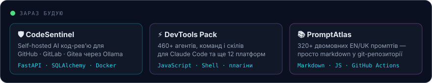

<p align="right">
  <a href="README.md"></a>
  
</p>

<p align="center">
  
</p>

<p align="center">
  
</p>

<p align="center">
  <a href="https://github.com/Mattakushi432?tab=repositories"></a>
  <a href="https://github.com/Mattakushi432?tab=followers"></a>
  
  
</p>

---

### `$ cat about.md`

Я Максим — Python-розробник з України. Почав з алгоритмів і базового
Python, пройшов увесь веб-трек (Flask → Django → FastAPI,
SQL → SQLAlchemy → MongoDB, потоки → asyncio → черги повідомлень), а зараз
здебільшого роблю **інструменти, які пришвидшують роботу розробників**:
self-hosted AI код-рев’ю, набори скілів для AI-агентів і невеликі утиліти
для Windows, кожна з яких добре робить одну справу.

Що їх об’єднує: мені подобається софт, який працює **на твоїй власній
машині**, зрозуміло пояснює, що робить, і нікуди нічого не відправляє.
Локальні LLM замість хмарних API, де це можливо; один Docker Compose файл
замість десятисторінкової інструкції; один `.exe` замість інсталятора, якому
без причини потрібні права адміністратора.

Документацію пишу англійською та українською (іноді російською) —
двомовність у моїх проєктах закладена з самого початку, а не додана потім.

---

### `$ ls ~/stack`

<table>
  <tr>
    <td width="150"><b>Бекенд</b></td>
    <td>
      
      
      
      
      
      
      
      
    </td>
  </tr>
  <tr>
    <td><b>Дані та черги</b></td>
    <td>
      
      
      
      
      
      
    </td>
  </tr>
  <tr>
    <td><b>AI та агенти</b></td>
    <td>
      
      
      
      
      
    </td>
  </tr>
  <tr>
    <td><b>Десктоп і боти</b></td>
    <td>
      
      
      
      
      
      
    </td>
  </tr>
  <tr>
    <td><b>Інфраструктура</b></td>
    <td>
      
      
      
      
      
      
    </td>
  </tr>
</table>

---

### `$ ls ~/projects --featured`

<table>
<tr>
<td width="50%" valign="top">

#### 🛡️ [CodeSentinel](https://github.com/Mattakushi432/CodeSentinel)
Self-hosted AI код-рев’ю. Отримує pull request’и з **GitHub, GitLab
і Gitea**, проганяє diff через локальну модель в **Ollama** і залишає
коментарі прямо в коді. Код не покидає твій сервер; Groq — опційний
резерв для пікових навантажень. Один Compose-стек: FastAPI + Ollama + Caddy,
працює на сервері без GPU з 8 ГБ RAM.

`FastAPI` `SQLAlchemy` `Alembic` `Ollama` `Docker` `Prometheus`

</td>
<td width="50%" valign="top">

#### ⚡ [DevTools Pack](https://github.com/Mattakushi432/Claude-Code-Skills-Custom-DevTools-Pack)
Набір інструментів для AI-асистентів, що встановлюється як **маркетплейс
плагінів Claude Code**: 37 агентів, 71 команда і 350+ скілів, з адаптерами
для 13 платформ. Усе — звичайні файли: читай, форкай, залишай лише те,
чим справді користуєшся.

`JavaScript` `Shell` `Claude Code` `плагіни`

</td>
</tr>
<tr>
<td width="50%" valign="top">

#### 📚 [PromptAtlas](https://github.com/Mattakushi432/PromptAtlas)
Відкрита бібліотека з 320+ промптів і технік для сучасних моделей,
**двомовна EN / UK**, і це просто markdown у git-репозиторії. CI-перевірка
стежить за паритетом мов, тож промпт не може існувати в одній версії
й непомітно зникнути з іншої.

`Markdown` `GitHub Actions` `i18n`

</td>
<td width="50%" valign="top">

#### 🔐 [GeneratorPassword](https://github.com/Mattakushi432/GeneratorPassword)
Генератор паролів і парольних фраз для Windows 11 на **Flet**.
Довжина 4–128, до 20 штук за раз, виключення схожих символів,
гарантовані типи символів і фрази зі словника EFF.
Інтерфейс українською та англійською.

`Python` `Flet` `PowerShell`

</td>
</tr>
<tr>
<td width="50%" valign="top">

#### 🧰 [Windows Customization Toolkit](https://github.com/Mattakushi432/Windows-Customization-Toolkit)
Збирай власний образ Windows: редагування WIM-файлів, видалення
застосунків і компонентів, твіки реєстру, інтеграція програм, генерація
файлів автоматичного встановлення і створення завантажувального ISO.

`Python` `WIM` `PowerShell`

</td>
<td width="50%" valign="top">

#### 🌐 [ProxySwitch](https://github.com/Mattakushi432/ProxySwitch)
Десктоп-застосунок для перемикання системного проксі між профілями
(HTTP / HTTPS / SOCKS5). Запускає локальний routing-проксі на `127.0.0.1`,
який за правилами вирішує, що йде через upstream, а що — напряму.

`Python` `CustomTkinter` `мережі`

</td>
</tr>
</table>

<details>
<summary><b>Ще: боти, перекладачі, веб-застосунки</b></summary>
<br/>

| Проєкт | Що це | Стек |
|---|---|---|
| [TG_bot_trenier](https://github.com/Mattakushi432/TG_bot_trenier) | AI-тренер у Telegram з двома персонажами-тренерами, адаптивні програми тренувань і харчування | Python · Gemini · SQLite |
| [bot_telegram](https://github.com/Mattakushi432/bot_telegram) | Telegram-асистент на Gemini з підтримкою зображень | python-telegram-bot · Gemini |
| [main_translate](https://github.com/Mattakushi432/main_translate) | Екранний перекладач для Linux: виділи область, розпізнай текст (OCR), переклади | Python · OCR · Shell |
| [CodeLearn](https://github.com/Mattakushi432/CodeLearn_my_pet_project) | Платформа онлайн-курсів з JWT-автентифікацією | Django · DRF · Docker |
| [SchoolDiary](https://github.com/Mattakushi432/SchoolDiary) | Веб-застосунок «шкільний щоденник» | Python · HTML |
| [zabbix_agent_script](https://github.com/Mattakushi432/zabbix_agent_script) | Допоміжний скрипт для агента Zabbix | Python · Zabbix |
| [ConvertEXCEL_TO_CSV](https://github.com/Mattakushi432/ConvertEXCEL_TO_CSV) | Конвертер Excel → CSV | Python |

</details>

<details>
<summary><b>Шлях навчання — усі домашні завдання публічні</b></summary>
<br/>

```text
алгоритми ──▶ базовий python ──▶ ООП та ABC ──▶ потоки / процеси ──▶ asyncio
    │                                                                   │
    ▼                                                                   ▼
  SQL ──▶ SQLAlchemy + Alembic ──▶ MongoDB + RabbitMQ ──▶ Scrapy ──▶ Django ──▶ FastAPI + JWT
                                                                                │
                           тести · моки · кешування · XML ◀─────────────────────┘
```

GoIT: [`goit-algo-*`](https://github.com/Mattakushi432?tab=repositories&q=goit-algo) ·
[`goit-pycore-*`](https://github.com/Mattakushi432?tab=repositories&q=goit-core) ·
[`goit-pyweb-*`](https://github.com/Mattakushi432?tab=repositories&q=goit-pyweb) —
Hillel: [`*_hillel`](https://github.com/Mattakushi432?tab=repositories&q=hillel)

</details>

---

### `$ how-i-work`

- **Спершу локально.** Якщо модель чи сервіс можуть працювати на власному
  залізі користувача — це варіант за замовчуванням; хмара — запасний план,
  а не вимога.
- **Запуск однією командою.** Якщо для старту потрібно більше, ніж
  `docker compose up` або подвійний клік по `.exe`, — наступним виправляю
  саме налаштування.
- **Дві мови з першого дня.** Додати переклад потім завжди дорожче, ніж
  з самого початку тримати два файли синхронізованими.
- **Спершу читаю, потім форкаю.** Я багато форкаю чужих інструментів, щоб
  їх вивчити, — корисні ідеї потрапляють у мої проєкти, переписані
  й без зайвого.

---

### `$ git log --stat`

<p align="center">
  
  
</p>

<p align="center">
  
</p>

<sub>Картки генерує <a href="scripts/gen_stats.py"><code>scripts/gen_stats.py</code></a>,
а GitHub Action оновлює їх щодня — без сторонніх сервісів статистики.</sub>

---

### `$ contact`

Найшвидше зі мною можна зв’язатися через issue або discussion у будь-якому
з репозиторіїв вище — я їх читаю і відповідаю там.

<!-- Додайте свої посилання, наприклад:
<a href="https://t.me/your_handle"></a>
<a href="https://linkedin.com/in/your-profile"></a>
-->

<p align="center">
  
</p>
